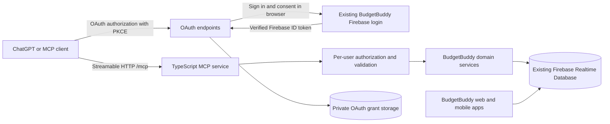

# BudgetBuddy MCP: design and ECC implementation plan

Status: approved and implemented locally. Automated verification is complete; live deployment and ChatGPT account linking require the owner's Firebase, hosting, and ChatGPT configuration.

Date: 2026-10-12. Implementation status updated 2026-10-13.

## Intended result

Connect ChatGPT and compatible MCP clients to the same Firebase account and data used by BudgetBuddy. Users can ask for spending analytics, create personal or shared expenses, correct expenses, remove expenses, manage budgets, and use the app's other existing business features.

Example: “Add ₹250 for lunch today, paid in cash” creates an expense in BudgetBuddy. “Change that to ₹200” updates the identified record and its splits together. “Show my food spending this month” returns the signed-in user's accepted shares, not everybody's expenses.

The user wants to use the same email as their ChatGPT account. The connection will ask them to sign into the corresponding BudgetBuddy account in the browser. Access is bound to the verified Firebase UID, not an email supplied in conversation. Standard MCP account linking does not give this service a verified ChatGPT-user email to compare, so automatically enforcing equality between the two account emails is not part of this design. The implementation supports a separate connection for each BudgetBuddy user and also works for one personal user. ECC is provisionally interpreted as Everything Claude Code.

## Repository findings

| Source | Finding and implication |
| --- | --- |
| `budget-buddy/frontend/src/firebase.ts` | The live frontend uses Firebase Authentication and Realtime Database. |
| `budget-buddy/frontend/src/api/services.ts` | Business operations execute in the browser against Firebase, not the FastAPI service. Importing this module into a server would fail because it depends on browser authentication and localStorage. |
| `budget-buddy/frontend/src/types/index.ts` | Existing shapes cover expenses, splits, groups, friendships, settlements, budgets, notifications, and users. Preserve compatible persisted fields. |
| `budget-buddy/frontend/src/api/services.ts:632` | Expense updates change the amount without recalculating shares. MCP updates must commit a consistent expense and split set. |
| `budget-buddy/frontend/src/api/services.ts:795` | The current balance display includes pending settlements. Return confirmed balances and pending amounts explicitly so a recorded payment is not mistaken for a confirmed payment. |
| `budget-buddy/frontend/src/api/services.ts:1010` | Analytics sum the user's accepted split amounts. Do not count an entire shared bill as the user's spending. |
| `budget-buddy/frontend/src/pages/ProfilePage.tsx` | Email changes require reauthentication. Agent tools must direct the user to the account page for these changes rather than collect passwords. |
| `budget-buddy/frontend/src/api/services.ts:1202` | Telegram linking depends on a separate bot HTTP service. That service is not established by the inspected frontend code. |
| `budget-buddy/mobile/database.rules.json` | Checked-in rules are not proof of deployed rules. Several collections permit broad authenticated reads. MCP must enforce its own per-user authorization because Admin SDK operations bypass client rules. |
| `.github/workflows/ci.yml` | CI covers frontend and legacy backend; add a separate MCP verification job. |
| `render.yaml` | Existing deployment provisions FastAPI/Postgres. A new MCP service needs its own configuration. |

No existing MCP server, Node server test convention, or installed ECC workflow was found in the searched project/user skill locations. Follow the upstream ECC instructions inline; do not pretend its slash commands were installed or executed.

## Approaches considered

1. **Separate TypeScript MCP service using Firebase — recommended.** Keeps the current data and login, isolates server credentials from the browser, and fits the existing TypeScript models. Requires a deployed service and an OAuth adapter for Firebase sign-in.
2. **Add MCP to FastAPI.** Reuses a server framework, but the existing PostgreSQL data is separate from the production Firebase data. This would require a Firebase adapter anyway or a larger app migration.
3. **Personal local MCP server only.** Useful for a local agent, but insufficient as the complete multi-user ChatGPT integration and deployment requested here.

## Architecture



Create `budget-buddy/mcp-server` using Node 24, strict TypeScript, the official MCP TypeScript SDK, Zod, Firebase Admin, and a supported HTTP framework. Select and lock compatible dependency versions during implementation. Use a stateless Streamable HTTP MCP transport, with fresh request authentication and no globally shared current-user state.

Expose `/mcp`, `/health`, OAuth authorization-server discovery, protected-resource metadata, and authorization/token/revocation endpoints. Host the browser sign-in/consent route within the existing frontend so its enabled Firebase sign-in methods remain usable. Store OAuth grants separately under a server-only Firebase namespace; no production runtime memory-only token store.

The MCP layer owns tool metadata and protocol errors. Domain services own permission checks and business rules. A repository adapter owns Firebase access. The agent interprets natural language; the server accepts validated structured arguments. No OpenAI API key or additional language model call is needed just to expose the MCP tools.

## Authentication and authorization

- Firebase sign-in establishes the user's UID. OAuth credentials issued for MCP are distinct from Firebase ID tokens; do not pass a Firebase token through as a general MCP access token.
- Use the MCP SDK's supported authorization interfaces and maintained cryptographic libraries. Support authorization code with S256 PKCE, exact registered redirects, state binding, resource/audience binding, short-lived access tokens, refresh rotation, and revocation.
- Use configured OAuth clients for the first deployment. Publish only registration methods actually implemented. Copy ChatGPT's exact callback URI from its connection page; do not wildcard redirects. Dynamic registration or CIMD is optional future work, not a claimed prerequisite for a configured client.
- Bind consent to the OAuth client, redirect, resource, requested scopes, and authenticated user. Reject replayed or expired codes and cross-origin consent submissions. Do not put ID/access/refresh tokens in URLs.
- Offer separate `budgetbuddy:read` and `budgetbuddy:write` scopes. Read-only grants cannot execute writes. Authentication applies to every request and mutation.
- Store only hashes of opaque bearer/refresh tokens and codes where practical; never log credentials or financial payloads. Protect private grant/idempotency records from browser/mobile access.
- Derive the actor from verified authentication. Tools never accept an authoritative caller UID. Target IDs are validated, then checked for visibility and ownership.
- Expense reads require payer/participant access, or explicitly authorized group visibility; update/delete require the payer. Group administration requires the creator. Friend-request acceptance/rejection requires the receiver. Settlement approval requires its receiver.
- Public user results omit UPI IDs, phone numbers, and private profile fields. Profile writes use a field allowlist. Account credential changes stay in the reauthenticated browser flow.
- Add body-size limits, safe host/origin checks, request timeouts, rate limits, safe errors, and bounded result pagination. Do not silently truncate inputs to analytics and present partial totals as complete.

## Tool coverage

Use explicit tool names instead of an unrestricted “run database operation” tool. Every tool has input and output schemas, useful descriptions, and truthful read/write/destructive annotations.

| Area | Planned tools | Behavior |
| --- | --- | --- |
| Context | `get_account_context` | Current account, currency, timezone, today's date, and enabled capabilities. |
| Profile | `get_profile`, `update_profile`, `search_users`, `get_user` | Edit permitted own-profile fields; minimal public lookup results. |
| Categories | `list_categories`, `create_category`, `delete_category` | Existing built-in categories plus the user's custom categories. Deleting a category does not erase expenses. |
| Expenses | `list_expenses`, `get_expense`, `create_expense`, `update_expense`, `delete_expense`, `update_split_status` | Personal/shared expenses; date/category/title/group filters; owner writes; split-status changes restricted to the affected participant. Group listing uses `list_expenses(group_id=...)`. |
| Groups | `list_groups`, `get_group`, `create_group`, `update_group`, `delete_group`, `add_group_member`, `remove_group_member` | Normalize legacy member formats. Block deleting a group or removing a member when it would strand outstanding shared records. |
| Friends | `list_friends`, `list_friend_requests`, `send_friend_request`, `accept_friend_request`, `reject_friend_request`, `remove_friend` | Enforce sender/receiver permissions; prevent duplicate or self requests. |
| Settlements | `list_settlements`, `get_balances`, `record_settlement`, `approve_settlement` | Record a pending payment; receiver confirms. Report pending and completed totals separately. Recording never transfers money. |
| Budgets | `list_budgets`, `get_budget`, `create_budget`, `update_budget`, `get_budget_summary` | Preserve existing monthly budget IDs and accepted-share spending semantics. |
| Analytics | `get_dashboard`, `get_monthly_spending`, `get_category_spending`, `get_spending_trends` | Correct date boundaries, empty periods, rounding, and signed-in-user shares. |
| Notifications | `list_notifications`, `mark_notifications_read` | Read and mark only the caller's notifications; reproduce app notifications for shared mutations. |
| Telegram integration | `get_telegram_status` | Returns a clear unavailable capability with setup guidance. Link/unlink mutations remain unregistered because the external bot's authenticated contract is not established. |

This maps the current business features. Register/login/refresh are authentication flows, not tools that expose passwords to the model. Email/password changes open the secure account UI. Multi-currency conversion, receipt upload, recurring expenses, and actual payment execution are not implemented app features and are not implied by this plan.

## Expense correctness and conversational behavior

- Store amounts in existing major-unit fields but calculate with integer minor units. Reject non-positive/non-finite amounts, excessive precision, and unsupported currency assumptions.
- Personal expenses default participants to the actor. Do not guess other users or group IDs; look up candidates and disambiguate.
- Equal splits distribute rounding remainders deterministically. Percentage splits must total 100; custom splits must sum exactly to the expense amount. Participants must be distinct and authorized.
- Updating a personal or equal-split amount recalculates shares atomically. For percentage/custom records lacking original allocation details, require an explicit replacement allocation when changing the total; never leave stale shares.
- Preserve or deliberately reset split acceptance according to the changed allocation and document the rule. Changed other-user obligations require renewed acknowledgement, rather than silently preserving acceptance.
- Use idempotency keys for creates and settlement recording. Bind each key to actor, operation, and payload hash. Retrying the same operation returns the original result; a mismatched payload is rejected.
- Use record revisions/transaction checks for stale updates and deletes, including records initially written by the web app. Multi-path writes keep expenses, notifications, and idempotency results consistent.
- Resolve relative dates using a documented account/server timezone, initially `Asia/Kolkata`, and return the interpreted calendar date. Require a real ISO calendar date at the tool boundary.
- A delete targets a resolved stable ID. Tool descriptions instruct the agent to clarify ambiguous matches. The client receives destructive metadata and handles its write authorization UI; server authorization is independently enforced.

## Proposed file layout

```text
budget-buddy/mcp-server/
  package.json, package-lock.json, tsconfig.json
  .env.example, .gitignore, Dockerfile, render.yaml
  src/
    index.ts, http.ts, config.ts
    auth/                 # OAuth adapter, storage, consent validation
    repositories/         # Firebase access and transactions
    domain/               # permissions, money, expenses, social, analytics
    tools/                # schemas, metadata, registration, error mapping
  tests/                  # domain, authorization, OAuth, transport integration
  README.md
budget-buddy/frontend/src/pages/McpConsentPage.tsx
budget-buddy/frontend/src/App.tsx
docs/MCP_SETUP.md
.github/workflows/mcp.yml
```

Avoid importing the browser's `services.ts` into the server. Reuse compatible types and extract small pure calculation helpers only where this improves consistency without restructuring unrelated app code.

## ECC delivery sequence

1. **Plan — complete.** The user approved this design before implementation.
2. **Test first — complete.** Domain/repository contracts cover identity isolation, exact split math, expense CRUD, budgets, analytics, OAuth replay protection, and Firebase emulator behavior.
3. **Implement core — complete.** The server package, validated configuration, Firebase adapter, account-scoped services, and MCP transport are implemented. Official SDK client tests discover and call the tools.
4. **Complete feature coverage — complete.** The 43-tool catalog covers the established app features with permission tests. Telegram mutations remain disabled because the external contract is not established.
5. **Implement OAuth and consent — complete.** Persisted grants, S256 PKCE, metadata, scopes, refresh/revocation, and the Firebase-backed frontend consent route are implemented and tested.
6. **Verify and review — complete locally.** Typecheck/build, domain/protocol tests, Firebase emulator tests, runtime audit, frontend tests/build, and security boundary review pass. Server coverage exceeds the target.
7. **Document and package — complete.** Environment templates, Docker/Render assets, CI, examples, catalog, troubleshooting, and the complete setup guide are present.
8. **Connect and validate — external step.** Deploy using the owner's Firebase/hosting accounts, configure ChatGPT's exact OAuth callback, sign in interactively, and exercise create → list → update → analytics → delete. Do not claim a live connection until this succeeds.

ECC's upstream [plan command](https://github.com/affaan-m/everything-claude-code/blob/main/commands/plan.md) explicitly requires confirmation before code changes. The local [brainstorming skill](../../../.agents/skills/brainstorming/SKILL.md) also requires approval of the design. Planning is performed inline; no subagents are required by this chosen workflow.

## Acceptance tests

- A real MCP client initializes, lists tools, and completes expense create/read/update/delete against an emulator.
- An authenticated user cannot read or mutate another user's personal records, even with a valid guessed ID.
- One user's request cannot inherit another user's identity through a shared server instance or transport session.
- Retried writes do not create duplicate expenses, settlements, or notifications; payload conflicts fail explicitly.
- Equal split of 100.00 among three participants sums to exactly 100.00; invalid custom and percentage allocations fail before a write.
- Changing an expense's total cannot leave its shares or derived analytics stale.
- A shared bill contributes only the user's accepted share to spending; disputed/pending shares and settlement status are handled explicitly.
- Empty months, calendar year changes, timezone boundaries, invalid dates, deleted records, and pagination work predictably.
- Read-only OAuth grants cannot call write tools; expired/revoked tokens and replayed authorization codes fail.
- Authentication discovery, exact redirects, PKCE, resource binding, refresh, and revocation work through the actual HTTP service.
- The deployed endpoint and ChatGPT account linking are separately checked; local tests are not presented as production verification.

## Remaining external inputs

Implementation can proceed after design approval using Firebase emulators. Live deployment/connection subsequently needs the selected Firebase project, hosting access, a server-only Firebase credential, a public HTTPS hostname (or compatible tunnel), ChatGPT connection access, and interactive BudgetBuddy sign-in. Secrets belong in local environment files or hosting secret storage, not chat or source control.

## Sources checked

- [OpenAI MCP authentication](https://developers.openai.com/plugins/build/auth)
- [OpenAI connecting and testing an MCP server](https://developers.openai.com/plugins/deploy/connect-chatgpt)
- [ECC planning workflow](https://github.com/affaan-m/everything-claude-code/blob/main/commands/plan.md)

Review the live documentation again at implementation time for SDK versions and connection UI changes.
